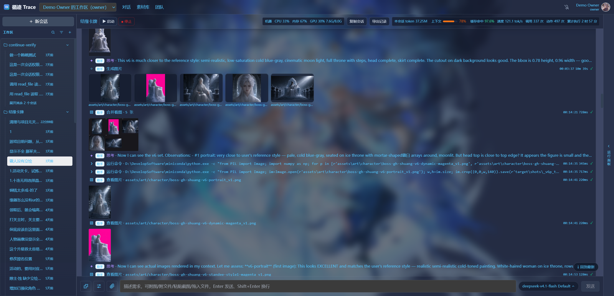
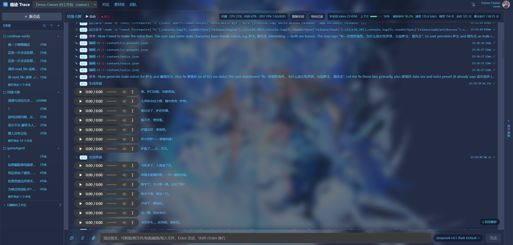
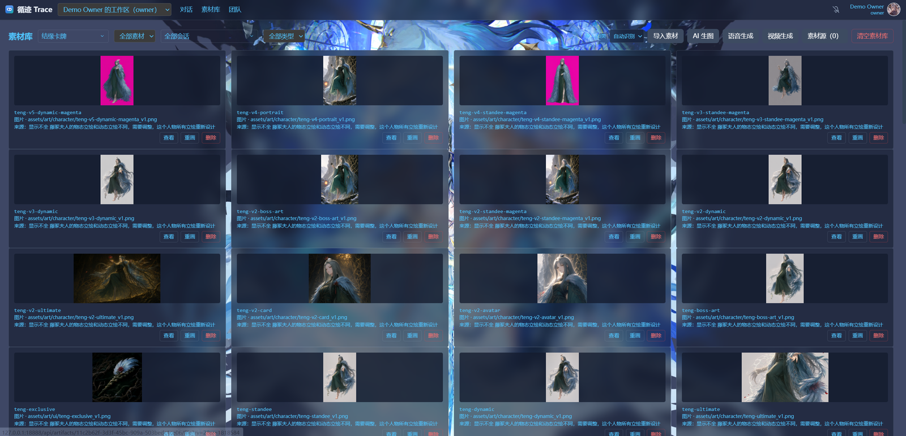
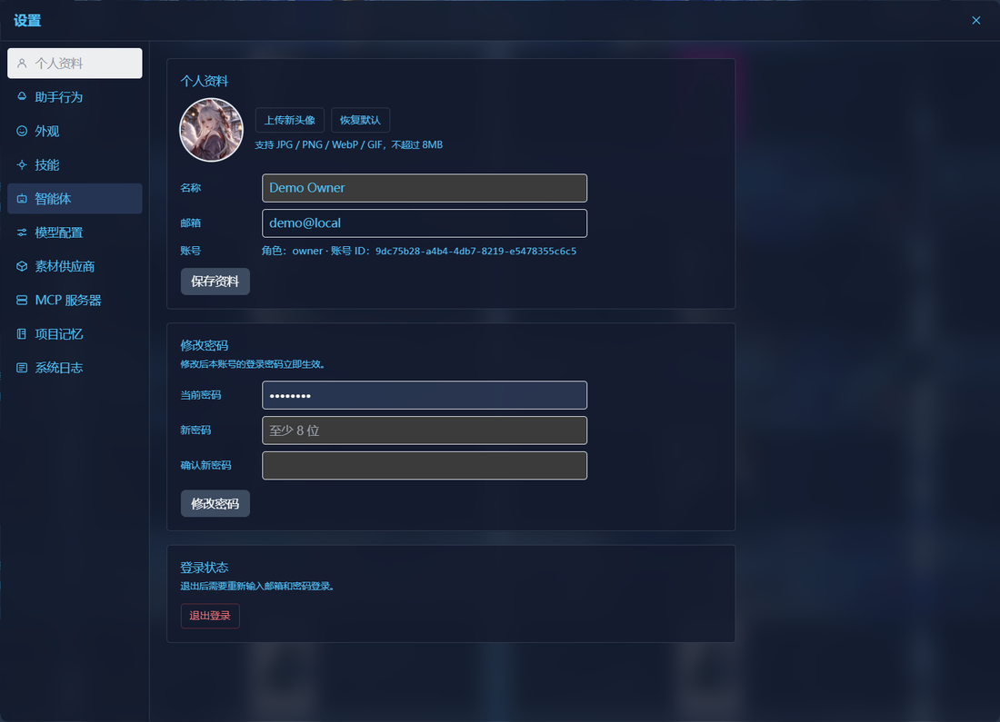

<div align="center">

# 循迹 · Trace

**个人版游戏开发智能体**

一句话需求 → 读代码、改代码、编译、起服务、截图验收，全部由 AI 助手自己完成；
出图 / 出音频 / 出视频直接生成；改动落成快照，供人审阅与回滚。

Python 3.12 · FastAPI · React 18 + TS · SQLite · 可打包单机运行

</div>

---

## 目录

- [什么是循迹](#什么是循迹)
- [核心特性](#核心特性)
- [它如何工作](#它如何工作)
- [界面预览](#界面预览)
- [快速开始](#快速开始)
  - [方式一：Windows 一键启动（lite）](#方式一windows-一键启动lite)
  - [方式二：从源码运行](#方式二从源码运行)
  - [方式三：从源码运行（开发）](#方式三从源码运行开发)
- [配置](#配置)
- [打包分发](#打包分发)
- [项目结构](#项目结构)
- [技术栈](#技术栈)
- [文档](#文档)
- [版本](#版本)

---

## 什么是循迹

循迹（Trace）是一个**个人用的游戏开发智能体**。你在自己的工作区里发一句话需求，
AI 助手就会像一名真正的开发者那样**从读到写、从改到验**，端到端完成改动：

- 读项目结构 → 定位文件 → 写/改代码 → 编译、跑单测；
- 需要美术 / 配音 / 视频时**直接调用**图像、语音、视频工具生成素材并落盘；
- 改完先做静态验证（编译 / 构建 / 单测）；**你要看效果时**才起服务 → 浏览器截图 →
  **自己看截图判断对错**（不对就改、重启、重截）；
- 最后交付一份**结构化变更清单**：这次动了哪些文件、净增删多少行、测试结论、新增素材。

> 平台**不接管你的 git**。代码直接写进工作区，但每次 run 在写文件前都会自动留下**改动前快照**，
> 因此任何改动随时可以**审阅 diff 并一键回滚**。

## 核心特性

- **单一执行者，端到端交付** —— 一个助手对用户负责：查文件、改代码、编译、验证、汇报全包，
  需要看真实页面效果时自己起服务截图验收；不再有「策划→开发→测试」多角色接力带来的多轮往返。
- **媒体直连生成** —— 助手可直接调用 `generate_image` / `generate_audio` / `generate_video`，
  按「美术模型 / 配音模型」绑定生成图片、语音、音效、BGM、视频并落到工作区。
- **零 key 也能跑通全链路** —— 未配置素材供应商时自动生成同路径同名的**占位素材**；
  之后配好 key 一键重画，只覆盖内容，代码零改动。
- **供应商驱动注册表** —— 图像 / 语音 / 音效 / 音乐均可插拔：加一个文件 + 一个装饰器即可接入新供应商，
  前端自动渲染配置表单。
- **改动快照 + 变更报告** —— 工具层写前快照，任何项目（无论有没有 `.git`）都能审阅、回滚，
  并生成结构化变更清单。
- **项目记忆** —— 跨任务保留项目入口事实（起服务命令、测试账号、登录入口），上下文只给标题索引、按需取，避免爆上下文。
- **长效执行** —— 没有「轮次预算 / 墙钟上限」，只有明确的停止、卡死检测、静默结束才会终止。
  过程事件（思考、压缩、经验沉淀、重试）以行内时间线显示在 trace 中。
- **单库单进程** —— 只用 SQLite（数据目录默认 `~/.trace`），无需安装任何数据库服务。
- **无需登录** —— 没有账号、密码、注册、找回：数据只在本机，打开页面即用（没有团队 / 成员 / 邀请概念）。
- **可打包分发** —— Windows 免安装 exe、Windows 便携版（需 Python）、Linux 便携包三套产物一键构建。

## 它如何工作

```
用户：给主界面加一个卡牌详情弹窗
        │
        ▼
  ┌──────────────────────────────────────────────────────────┐
  │  助手（唯一执行者）                                          │
  │   1. list_dir / grep / read_file   读项目、定位文件          │
  │   2. write_file / edit_file        改代码（写前自动快照）     │
  │   3. run_command                   编译 / 跑单测             │
  │   4. generate_image / generate_audio 缺素材时直接生成        │
  │   5. start_service / screenshot_page 起服务 → 截图 → 自检    │
  │   6. report_to_user                交付变更清单 + 验证证据   │
  └──────────────────────────────────────────────────────────┘
        │
        ▼
  变更报告：改了哪些文件 / 净增删行数 / 测试结论 / 新增素材
        │
        ▼
  用户：查看 diff 快照 → 满意保留，不满意一键回滚
```

## 界面预览

**对话 · 出图**（助手自己生成图片、多图拼看、看本地图自检）



**对话 · 出音**（批量生成配音 / 音效，行内时间线记录每一步工具调用）



**素材库**（按项目归档全部素材，可查看 / 重画 / 删除）



<table>
<tr>
<td width="50%"><b>设置 · 个人资料</b><br/></td>
<td width="50%"><b>设置 · 外观</b>（主题 / 主色 / 背景壁纸）<br/></td>
</tr>
</table>

## 快速开始

### 方式一：Windows 一键启动（lite）

最简单的方式，无需手动装依赖：

```bat
:: 双击 start.cmd（或命令行执行）
start.cmd
```

首次启动会自动创建 `.venv`、复制 `.env.example` 为 `.env`、用 SQLite 建库，服务就绪后**自动打开浏览器**访问
**http://127.0.0.1:18888**（打包版 exe 默认打开，源码运行默认不打开，设 `GA_OPEN_BROWSER=1` 可开）。
菜单提供：启动服务、停止服务。本版本没有账号密码，启动完直接就能用。

> ⚠️ 启动后需要在「设置 → 模型配置」里添加一个大模型供应商（填地址 + Key），
> 再到「设置 → 智能体」把「对话模型」绑上即可使用——程序只调用真实大模型，没有离线 mock 模式。

### 方式二：从源码运行

```bash
# 1) 创建虚拟环境（需 Python 3.12+）
python -m venv .venv
.venv\Scripts\activate          # Windows
# source .venv/bin/activate     # Linux / macOS

# 2) 安装依赖
pip install -r requirements.txt

# 3) 准备配置
copy .env.example .env          # Windows（Linux 用 cp）

# 4) 启动
python -m game_agent.main
```

打开 **http://127.0.0.1:18888** 即可。

### 方式三：从源码运行（开发）

本版本只用 SQLite，不需要安装任何数据库服务：

```bash
python -m venv .venv
.venv/Scripts/pip install -r requirements.txt   # Linux/macOS: .venv/bin/pip
.venv/Scripts/python -m game_agent.main
```

建表在启动时自动完成（`init_db()`，幂等，含轻量迁移）。数据库文件默认
`~/.trace/game_agent.db`（可用 `GA_DATA_DIR` 改目录，或 `DATABASE_URL=sqlite+aiosqlite:///<路径>` 改文件）。
首启会自动准备好「本机身份 + 一个工作区」（老库复用库里最早的账号，原有项目与会话不会丢），
没有注册/登录步骤，直接就能用。

数据目录（库 / 日志 / 上传 / 项目工作区）时间久了会把系统盘占满，所以
**设置 → 存储空间**里可以直接换位置并一键迁移：「浏览…」弹的是**系统原生文件夹窗口**（资源管理器同款，
能直接进别的盘 / 网络位置），选好后点迁移 → 全量复制到新目录（**带实时进度条**：已复制/总量、速度、剩余时间）
→ 写一个指针文件 `~/.trace_location` → 重启后生效 → 启动时自动清理旧目录（迁移当刻绝不删数据，
中途失败还能退回旧目录）。注意 `GA_DATA_DIR` 优先级高于这个指针，设了它就以它为准，
此时界面里的迁移不会生效（接口会直接拒绝并说明原因）。

## 配置

所有配置通过环境变量 / `.env` 提供，完整示例见 [`.env.example`](.env.example)。常用项：

| 变量 | 说明 | 默认 |
|---|---|---|
| `GA_MODE` | 运行模式（个人版固定 `lite`） | `lite` |
| `GA_DATA_DIR` | 数据目录（db / 工作区 / 密钥）；设了它就不再读设置页选的位置 | `~/.trace` |
| `GA_SECRET_KEY` | 会话 / 令牌签名与加密主密钥 | 自动生成 |
| `DATABASE_URL` | 数据库连接串；留空即用内置 SQLite（只支持 SQLite） | 空 |
| `PROJECTS_ROOT` | 项目工作区根目录（各项目所在） | `<DATA_DIR>/projects` |
| `GA_HOST` / `GA_PORT` | 监听地址 / 端口 | `127.0.0.1` / `18888` |
| `OPENAI_API_KEY` / `OPENAI_BASE_URL` / `GA_LLM_MODEL` | 可选的全局模型兜底 | 空 / OpenAI / `gpt-4o-mini` |
| `GA_SEED_DEMO` | 首启把 `examples/cardgame` 播种成示例项目 | `0` |
| `GA_OPEN_BROWSER` | 就绪后自动打开浏览器；不设时打包版默认开、源码默认关 | 空 |

素材供应商（图像 / 语音 / 音效 / 音乐）建议在界面「设置」中配置，未配置时走占位素材。

## 打包分发

```bat
package.cmd
```

菜单可产出三套产物到 `dist_release\`（含 `.sha256` 校验）：

| 产物 | 目标环境 |
|---|---|
| `Trace-win64-exe-<ver>.zip` | Windows 单文件 exe，零安装（PyInstaller） |
| `Trace-win64-lite-<ver>.zip` | Windows 便携版，目标机需 Python 3.12+ |
| `Trace-lite-linux-<ver>.tar.gz` | Linux 便携包（bash 脚本启停） |

前端会在打包时统一构建一次，供三套产物复用。

## 项目结构

```
game_agent/            # 后端
  agents/              #   单助手角色、工具实现、工具注册表
  api/                 #   FastAPI 应用与各路由（runs/sessions/projects/...）
  assets/              #   图像 / 语音 / 视频 / 素材供应商驱动
  auth/                #   本机身份（无登录）与权限常量
  core/                #   抽象、lite 容器、锁、队列、事件总线、技能、记忆
  db/                  #   SQLAlchemy 模型、会话、迁移
  llm/                 #   OpenAI / Anthropic 适配层、上下文、transcript
  orchestration/       #   编排器、快照、变更报告、项目记忆、策略
frontend/              # React 18 + TS + Vite + Tailwind 前端源码
web/dist/              # 前端构建产物（后端直接托管）
examples/cardgame/     # 自带示例项目（改代码 → 出素材 → 跑测试的靶子）
packaging/             # 三套打包脚本（windows-lite / exe / linux-lite）
deploy/unix/           # Linux 启停 / 备份脚本
scripts/               # 开发与运维脚本（种子数据、启停等）
tests/                 # pytest 测试
docs/                  # 设计文档与截图
```

## 技术栈

| 层 | 选型 |
|---|---|
| 后端 | Python 3.12 · FastAPI · SQLAlchemy 2 (async) · asyncio |
| 数据 | SQLite（`aiosqlite`，单文件零运维） |
| 前端 | React 18 · TypeScript · Vite · Tailwind · Zustand |
| 大模型 | OpenAI 兼容 · Anthropic（统一适配层） |
| 素材 | 供应商驱动注册表（Gemini / OpenAI 图像 / Seedream / Edge TTS / IndexTTS2 / MiniMax 音乐 / 本地音效库 / 外置 HTTP），零 key 走占位素材 |
| 视频 | 本地 ComfyUI（Wan2.2 等） |
| 打包 | PyInstaller（exe）· 便携 zip / tar.gz 一键构建 |

## 文档

- [设计文档 v0.3](docs/DESIGN.md)
- [桌面端评估](docs/DESIGN-DESKTOP.md)
- [断点续跑与记忆](docs/DESIGN-RESUME-MEMORY.md)
- [语音接入说明](docs/语音接入.md)

## 版本

当前版本 **v0.4.0**。

> 这是一个仍在快速迭代的项目。首个版本聚焦「单助手端到端执行 + 媒体直连 + 快照审阅」的核心闭环，
> 后续会持续完善素材工作台、评审合并与部署运维。

## License

本项目基于 [Apache License 2.0](LICENSE) 开源发布。

Copyright 2026 lisboy
